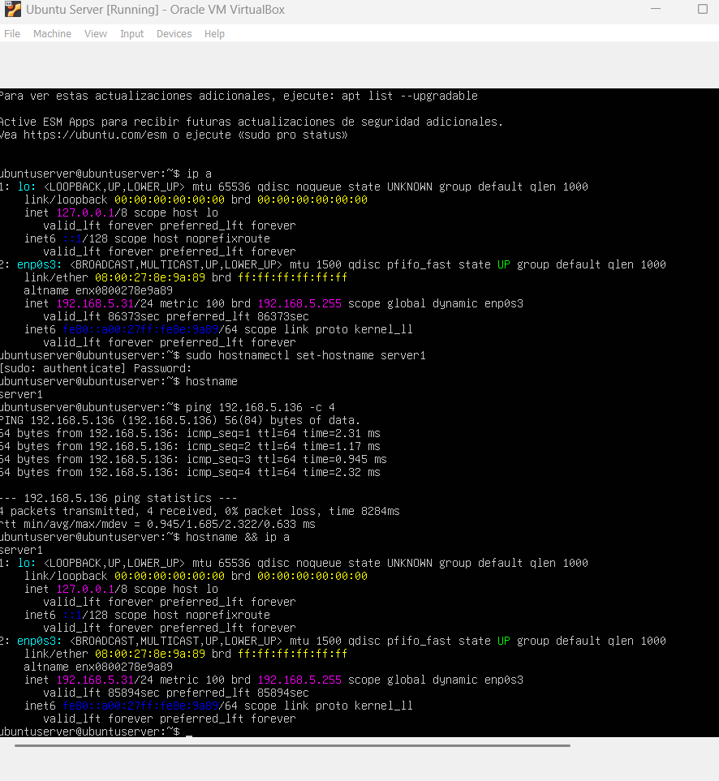
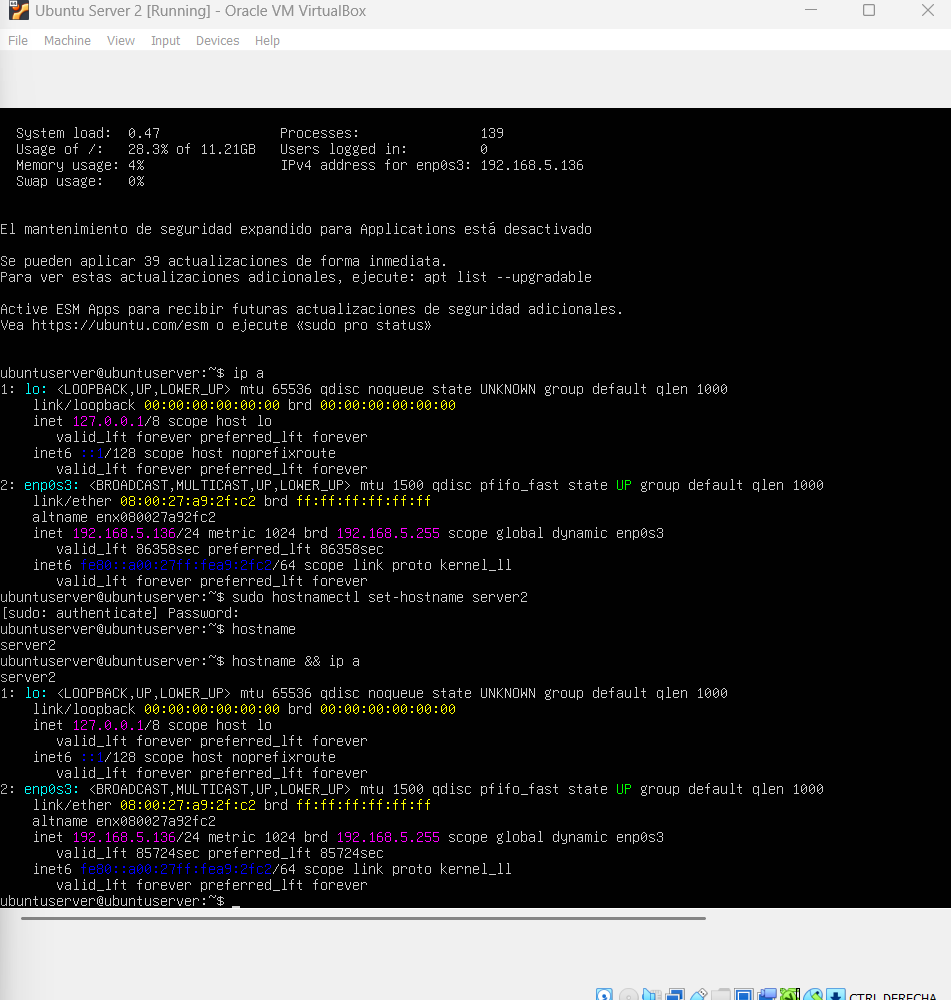

# Tarea 02 - Conexión host virtual a host virtual

## Descripción

En esta tarea se configuraron dos máquinas virtuales con Ubuntu Server 26.04 LTS en VirtualBox, ambas dentro de la subred local de la casa. Se asignó un hostname distinto a cada servidor y se verificó la comunicación entre ellos mediante ping.

---

## Configuración de red

### Server1

Se configuró el hostname como `server1` y se verificó su dirección IP con el comando `ip a`.



---

### Server2

Se configuró el hostname como `server2` y se verificó su dirección IP con el comando `ip a`.



---

## Ping desde server1 hacia server2

Una vez configurados ambos servidores en la misma subred, se ejecutó el ping desde server1 hacia server2 para comprobar la conectividad entre hosts virtuales.

```bash
ping 192.168.5.136 -c 4
```


---

## Resumen

* Servidor 1: 192.168.5.31 
* Servidor 2: 192.168.5.136 
