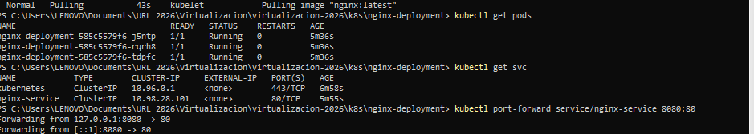
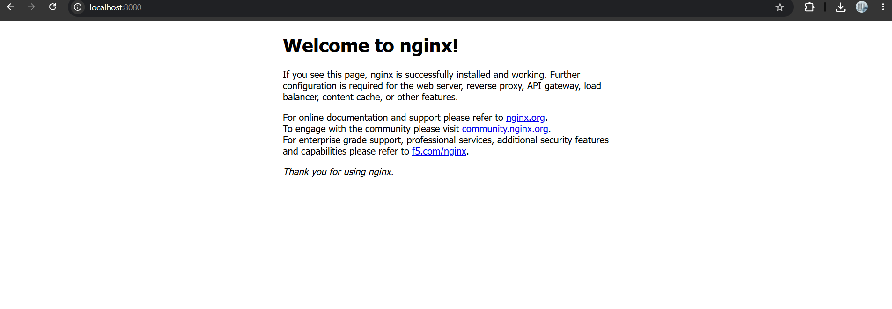

# Tarea 05 — Servicios en Kubernetes (Minikube)
Karla Elizabeth Lopez Avila - 1510421

## Descripción

Se desplegó Nginx en Kubernetes (Minikube con driver Docker) mediante un Deployment de 3 réplicas y se configuró un Service de tipo **ClusterIP** como código (IaC). Para acceder desde el navegador local se hizo un **port-forward hacia el Service** (no hacia el deployment), exponiendo el puerto 80 de Nginx en `localhost:8080`.

Namespace utilizado: `default`

## Pasos para reproducir

```bash
minikube start --driver=docker
cd k8s/nginx-deployment
kubectl apply -f nginx-deployment.yaml
kubectl apply -f nginx-service.yaml
kubectl get deployments
kubectl get pods
kubectl get svc
kubectl port-forward service/nginx-service 8080:80
```

Luego abrir en el navegador: `http://localhost:8080`

## Salida de `kubectl get svc` (namespace default)



## Llamada desde el navegador hacia el servicio de Nginx


