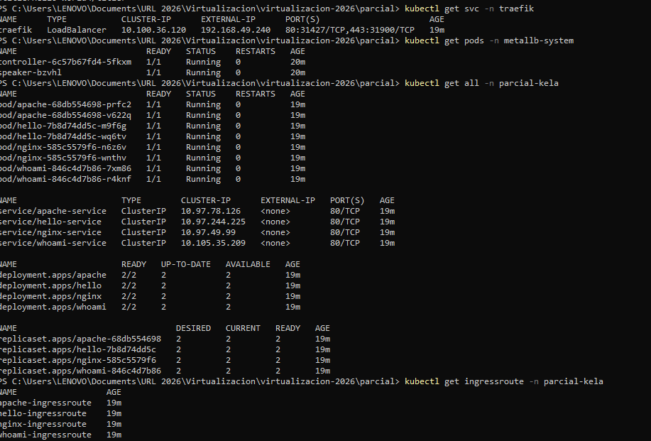
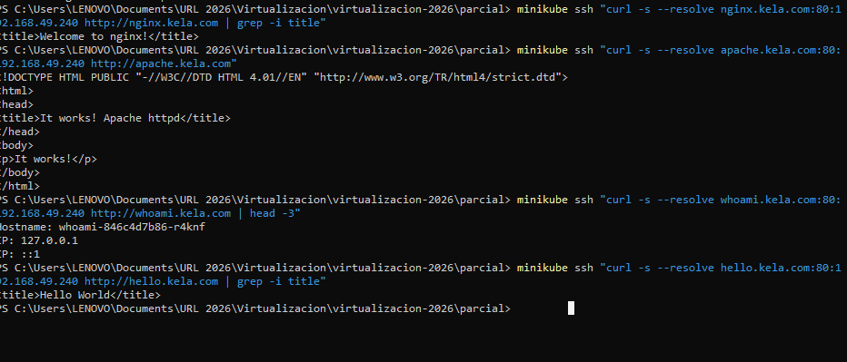
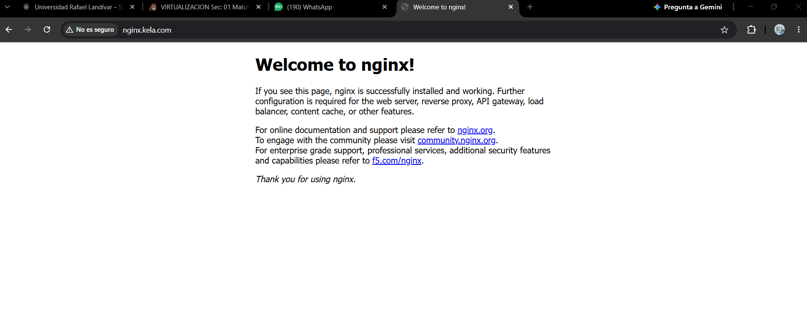
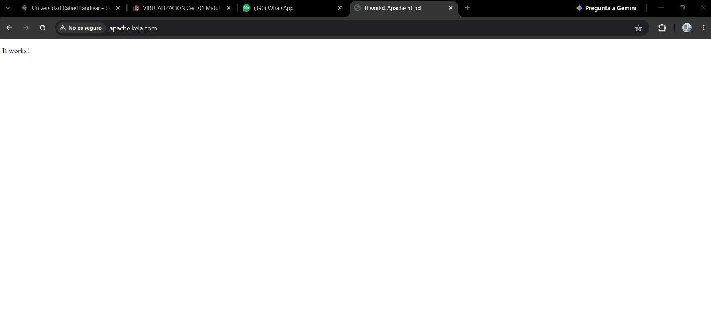
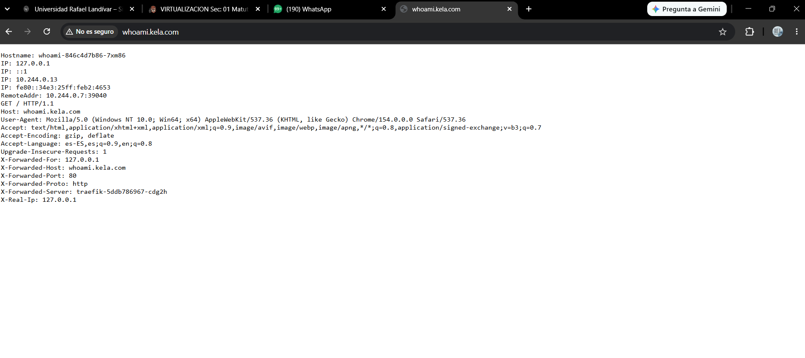
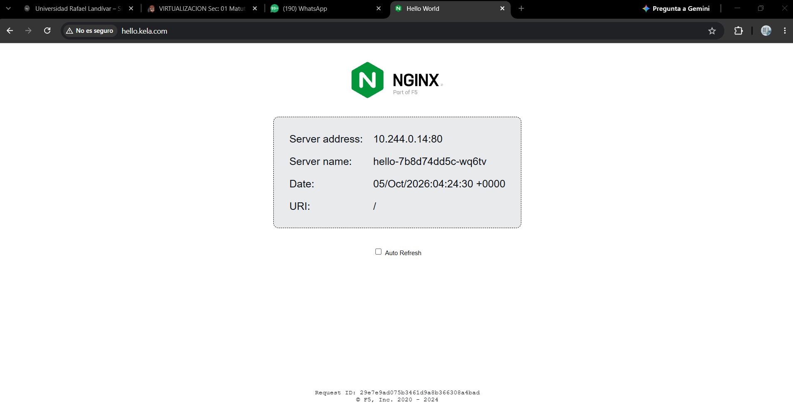

# Segunda Evaluación Parcial  — Kubernetes + MetalLB + Traefik
Karla Elizabeth Lopez Avila - 1510421

## Descripción

Se configuró un clúster local de **Minikube** (driver Docker) para exportar 4 aplicaciones web a través de una única IP. MetalLB administra un pool con una sola IP pública (`192.168.49.240`) y se la asigna al Service tipo LoadBalancer de Traefik. Traefik funciona como reverse proxy, según el nombre de dominio (header `Host`) de cada petición, la dirige al Service y a los Pods correspondientes. Toda la configuración se hizo como IaC (archivos YAML), sin Helm.

## Arquitectura

```
navegador ──> nginx.kela.com / apache.kela.com / whoami.kela.com / hello.kela.com
                 │  (DNS local: archivo hosts, registro tipo A)
                 ▼
     IP pública 192.168.49.240  <── asignada por MetalLB  [ns: metallb-system]
                 │
                 ▼
     Service LoadBalancer traefik ──> Pod Traefik (reverse proxy)  [ns: traefik]
                 │  IngressRoute: Host(`dominio`)
                 ▼
     Service (ClusterIP) ──> Deployment ──> Pods (2 réplicas)  [ns: parcial-kela]
```

## Pasos realizados

### 1. Iniciar Minikube

```powershell
minikube start --driver=docker
minikube ip          # 192.168.49.2: la IP del pool debe estar en esta red
```

### 2. Instalación de MetalLB

Se instaló con el manifiesto oficial, que crea su propio namespace `metallb-system`:

```powershell
kubectl apply -f https://raw.githubusercontent.com/metallb/metallb/v0.15.2/config/manifests/metallb-native.yaml
kubectl wait -n metallb-system --for=condition=ready pod --selector=app=metallb --timeout=180s
```

Configuración del pool con una sola IP pública (`metallb-config.yaml`):

```yaml
apiVersion: metallb.io/v1beta1
kind: IPAddressPool
metadata:
  name: pool-kela
  namespace: metallb-system
spec:
  addresses:
  - 192.168.49.240/32
---
apiVersion: metallb.io/v1beta1
kind: L2Advertisement
metadata:
  name: l2-kela
  namespace: metallb-system
spec:
  ipAddressPools:
  - pool-kela
```

### 3. Namespaces

```powershell
cd parcial
kubectl apply -f namespaces.yaml
kubectl apply -f metallb-config.yaml
```

### 4. Instalación de Traefik (sin Helm)

Se instalaron los CRDs de Traefik (`IngressRoute`, `Middleware`, etc.), sus permisos y el Deployment con su Service tipo **LoadBalancer**:

```powershell
kubectl apply -f https://raw.githubusercontent.com/traefik/traefik/v3.5/docs/content/reference/dynamic-configuration/kubernetes-crd-definition-v1.yml
kubectl apply -f traefik-rbac.yaml
kubectl apply -f traefik.yaml
```

Traefik escucha en el entrypoint `web` (puerto 80 del Service, 8000 del contenedor) y usa el proveedor `kubernetescrd` para leer los `IngressRoute` de todos los namespaces. Al ser `type: LoadBalancer`, MetalLB le asigna automáticamente la IP `192.168.49.240`.

### 5. Aplicaciones y servicios

```powershell
kubectl apply -f apps/
```

Cada archivo de `apps/` contiene un **Deployment** (2 réplicas), un **Service** ClusterIP y un **IngressRoute** con el nombre de dominio. 

```yaml
apiVersion: traefik.io/v1alpha1
kind: IngressRoute
metadata:
  name: nginx-ingressroute
  namespace: parcial-kela
spec:
  entryPoints:
    - web
  routes:
  - kind: Rule
    match: Host(`nginx.kela.com`)
    services:
    - name: nginx-service
      port: 80
```

Resultado de la instalación: MetalLB asignó la IP `192.168.49.240` como `EXTERNAL-IP` del Service de Traefik.



### 6. Configuración de DNS local

Se agregaron 4 registros tipo A al archivo `C:\Windows\System32\drivers\etc\hosts`


Con el driver Docker de Minikube en Windows, la red interna del clúster (`192.168.49.0/24`, donde está la IP de MetalLB) no es enrutable desde el host. Por eso:

1. Se comprobó dentro del nodo de Minikube que cada dominio, resuelto a la IP del LoadBalancer `192.168.49.240`, responde con su aplicación correcta. Esto demuestra el enrutamiento por dominio de Traefik sobre la IP de MetalLB:

```powershell
minikube ssh "curl -s --resolve nginx.kela.com:80:192.168.49.240 http://nginx.kela.com | grep -i title"
minikube ssh "curl -s --resolve apache.kela.com:80:192.168.49.240 http://apache.kela.com"
minikube ssh "curl -s --resolve whoami.kela.com:80:192.168.49.240 http://whoami.kela.com | head -3"
minikube ssh "curl -s --resolve hello.kela.com:80:192.168.49.240 http://hello.kela.com | grep -i title"
```



2. Para acceder desde el navegador de Windows, los dominios del archivo hosts apuntan a `127.0.0.1` y se hace un port-forward hacia el **Service LoadBalancer de Traefik**. Así, el tráfico sigue entrando por Traefik y es enrutado según el nombre de dominio:

```
127.0.0.1 nginx.kela.com apache.kela.com whoami.kela.com hello.kela.com
```

```powershell
kubectl port-forward -n traefik svc/traefik 80:80
```

Sin esta limitación de Windows, las entradas del hosts apuntarían directamente a la IP del LoadBalancer:

```
192.168.49.240 nginx.kela.com apache.kela.com whoami.kela.com hello.kela.com
```

## Acceso desde el navegador por nombre de dominio

### nginx.kela.com


### apache.kela.com


### whoami.kela.com


### hello.kela.com

