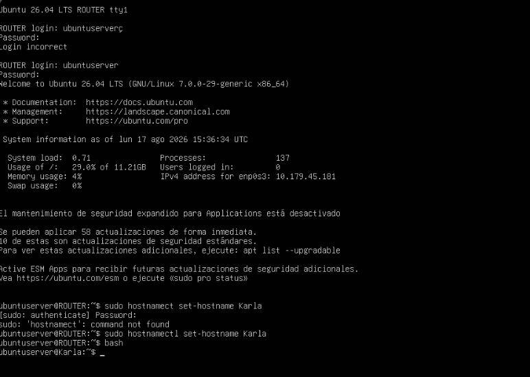
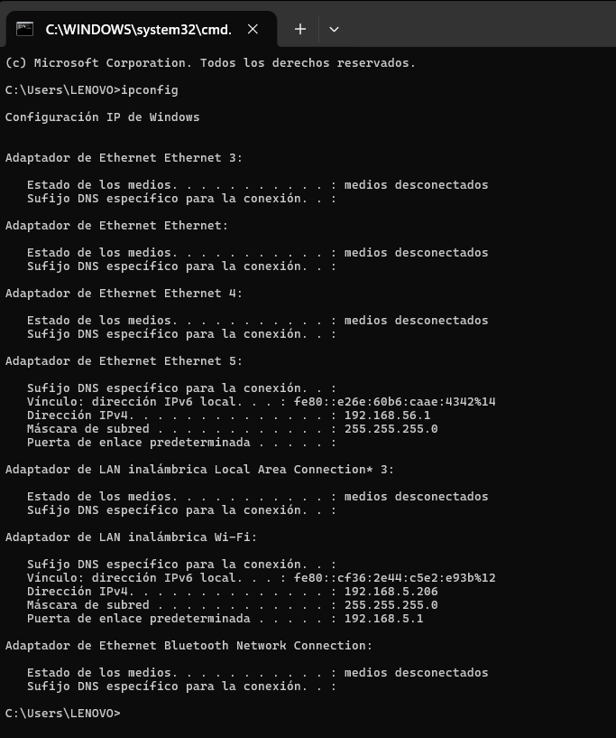
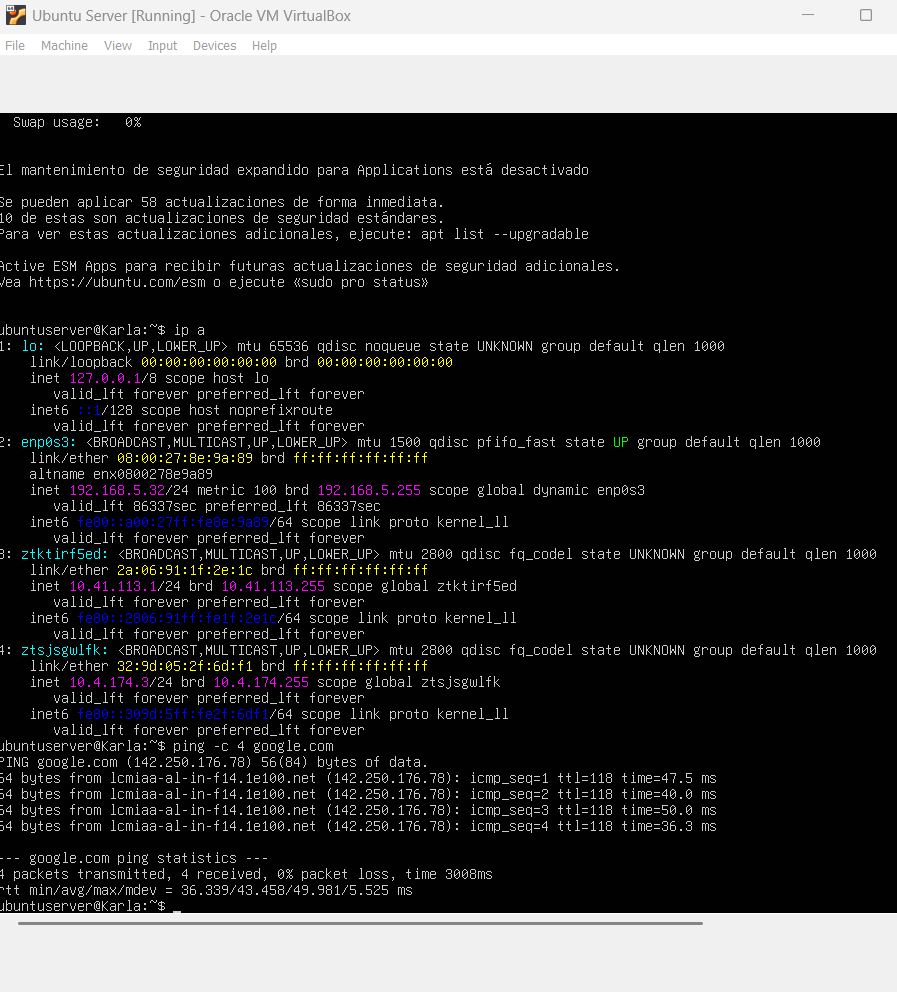
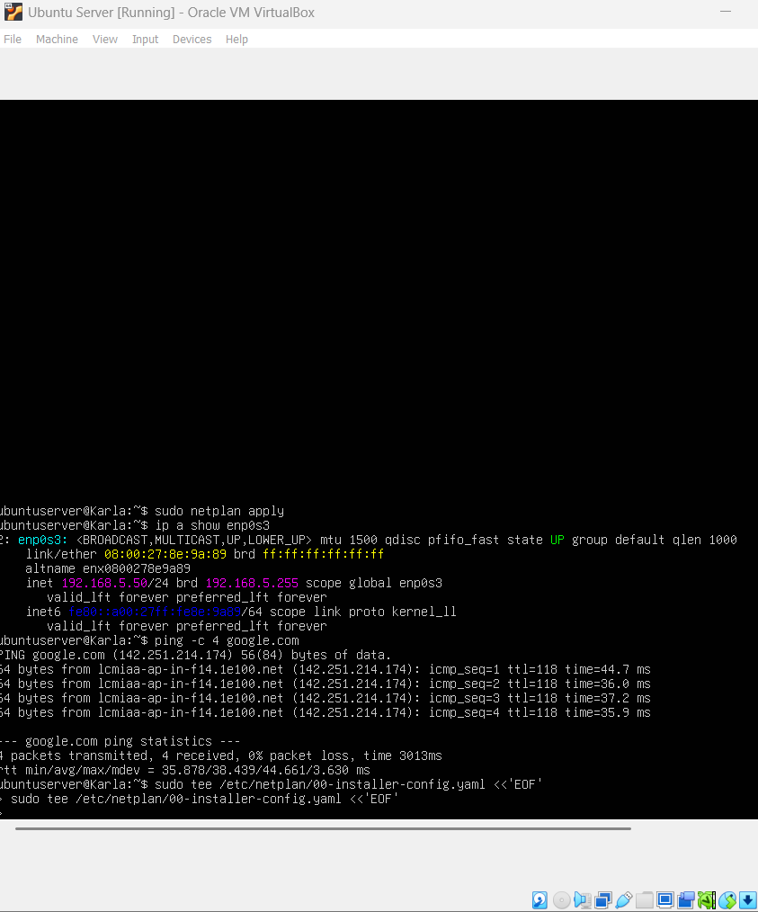
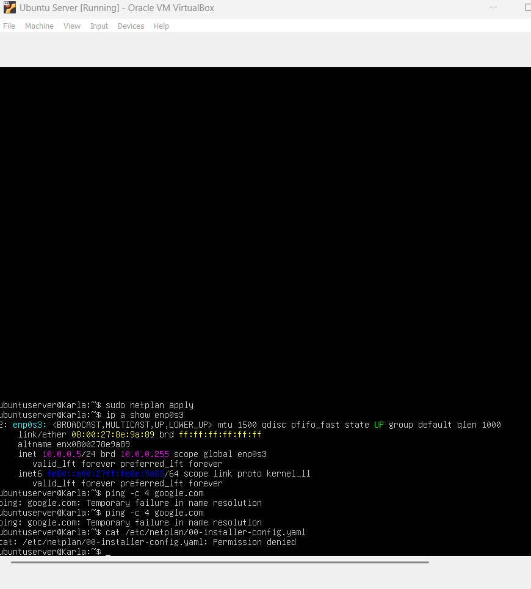

# Tarea 03 — Modos de red en VirtualBox (Bridge)
Karla Elizabeth Lopez Avila -1510421

## Descripción

En esta tarea se configuró una máquina virtual con Ubuntu Server 26.04 LTS en VirtualBox en modo Bridge, probando tres escenarios de configuración de red: IP por DHCP, IP estática dentro de la subred del hipervisor, e IP estática fuera de la subred del hipervisor. Se verificó la conectividad a internet mediante ping a google.com en cada escenario.

---

## Configuración del hostname

La máquina virtual fue configurada con el hostname **Karla**.

```bash
sudo hostnamectl set-hostname Karla
```



---

## Subred del hipervisor

El equipo anfitrión (hipervisor) está conectado en la subred **192.168.5.0/24** con gateway **192.168.5.1**.



---

## Escenario 1 — IP por DHCP

La máquina virtual obtiene su IP automáticamente por DHCP dentro de la subred del hipervisor.

- **IP asignada:** 192.168.5.32/24
- **Método:** DHCP

```bash
ip a show enp0s3
ping -c 4 google.com
```



---

## Escenario 2 — IP estática dentro de la subred

Se asignó manualmente una IP dentro de la misma subred del hipervisor (192.168.5.0/24).

- **IP asignada:** 192.168.5.50/24
- **Gateway:** 192.168.5.1

```bash
ping -c 4 google.com
```



---

## Escenario 3 — IP estática fuera de la subred

Se asignó manualmente una IP fuera de la subred del hipervisor. Al estar en una subred diferente (10.0.0.0/24), la VM no puede alcanzar el gateway (192.168.5.1) y pierde conectividad a internet.

- **IP asignada:** 10.0.0.5/24
- **Gateway configurado:** 192.168.5.1 (inalcanzable desde otra subred)

```bash
ping -c 4 google.com
```



---

## Resumen

* DHCP: 192.168.5.32/24, la subred fue correcta y el ping a google.com exitoso       
* Estática dentro: 192.168.5.50/24, la subred fue correcta y el ping a google.com exitoso     
* Estática fuera: 10.0.0.5/24, la subred fue incorrecta y el ping a google.com falló     
