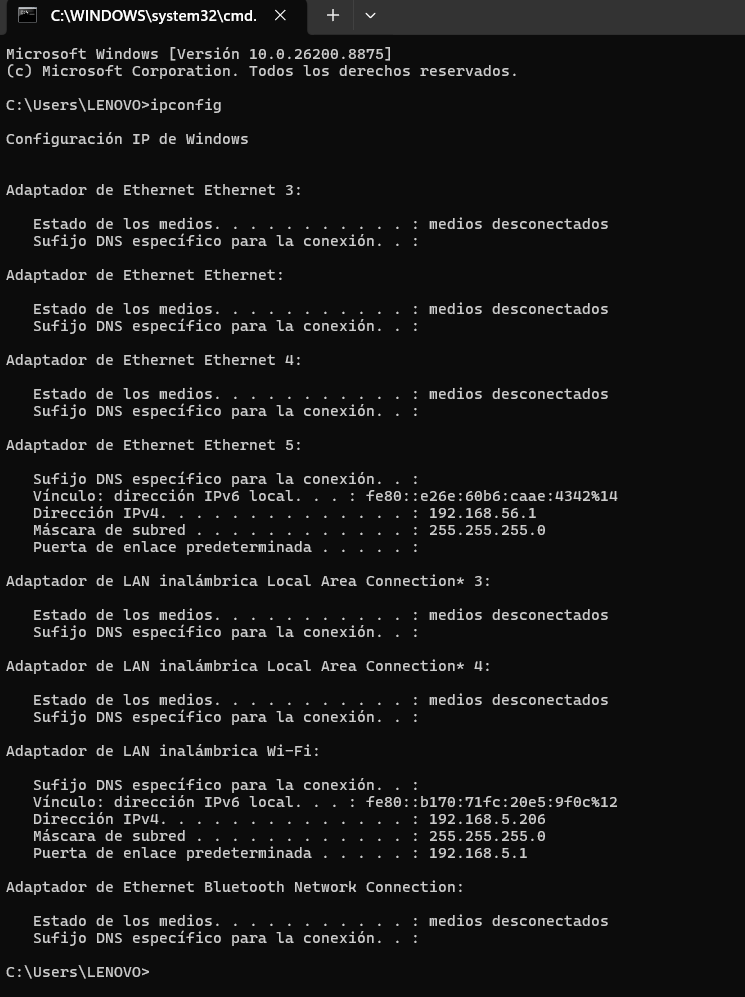
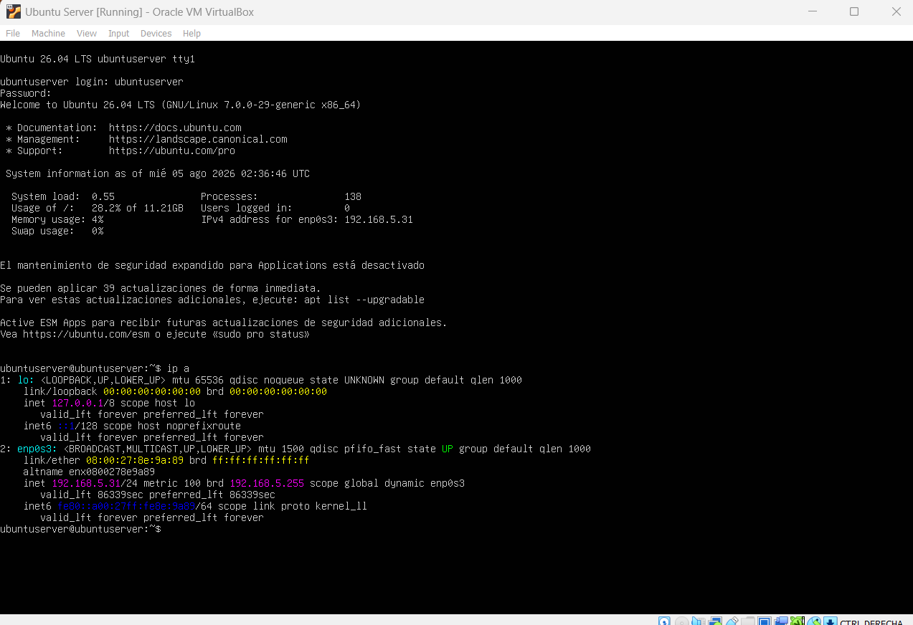
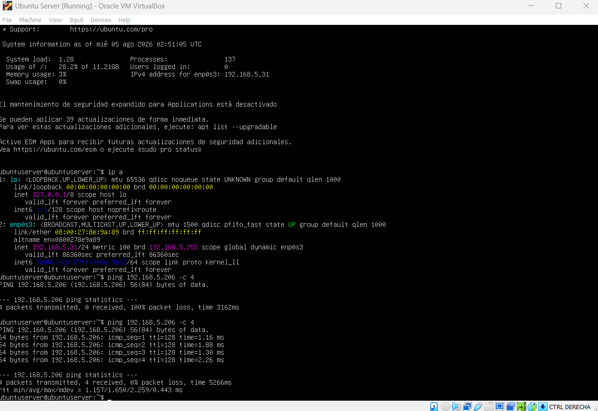

# Tarea 01 - Conexión host - máquina virtual

## Descripción

En esta tarea se configuró una máquina virtual con Ubuntu Server 26.04 LTS en VirtualBox para que forme parte de la subred local de la casa. El objetivo fue asignarle una IP dentro del mismo rango de red del host y verificar la comunicación entre ambos mediante ping.

---

## Configuración de red

### IP del host (máquina física)




---

### IP del servidor virtual (Ubuntu Server)
.



---

## Ping desde el servidor virtual hacia el host

Una vez configuradas ambas IPs en la misma subred, se ejecutó el ping desde la maquina virtual hacia el equipo anfitrión para comprobar la conectividad.

```bash
ping 192.168.5.206 -c 4
```



---

## Resumen de IPs

* Host (Windows): 192.168.5.206
* Servidor virtual (Ubuntu Server): 192.168.5.31
