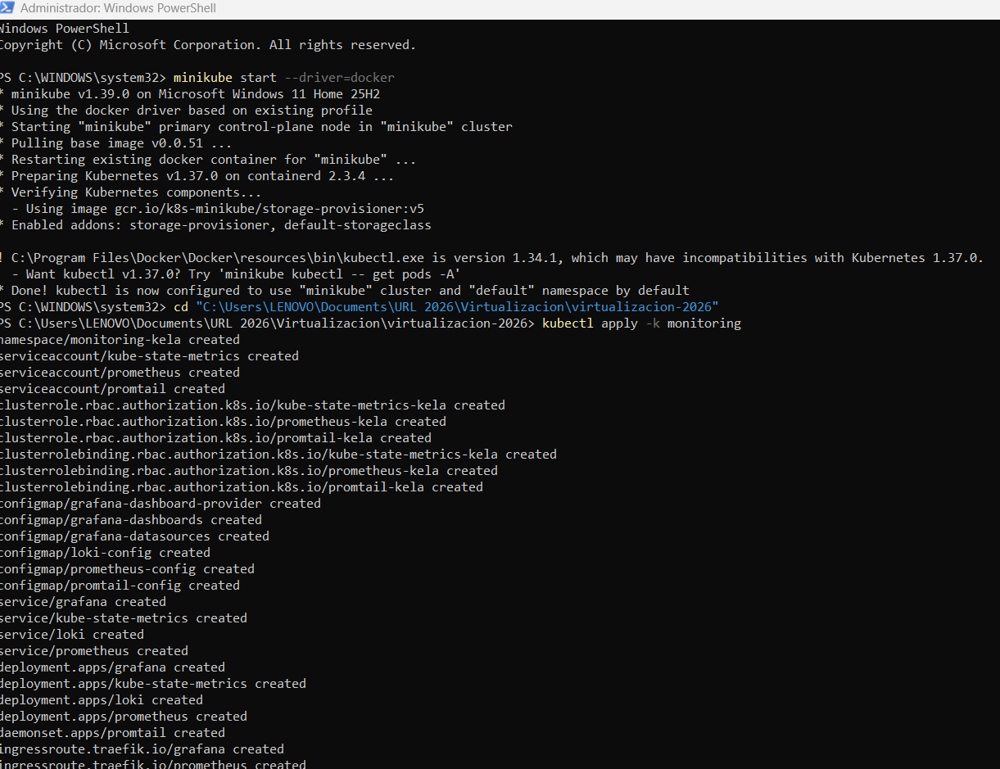
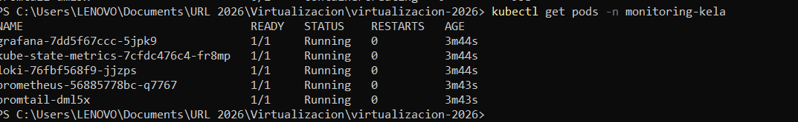
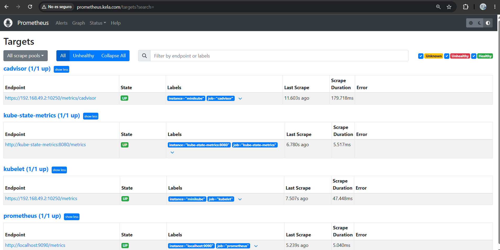
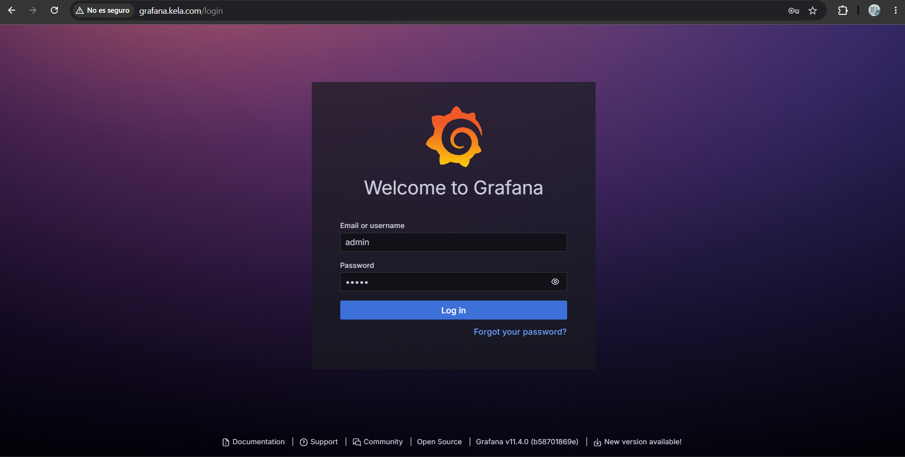
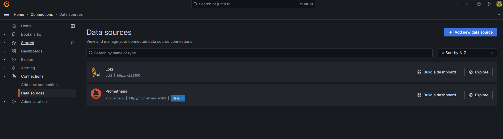
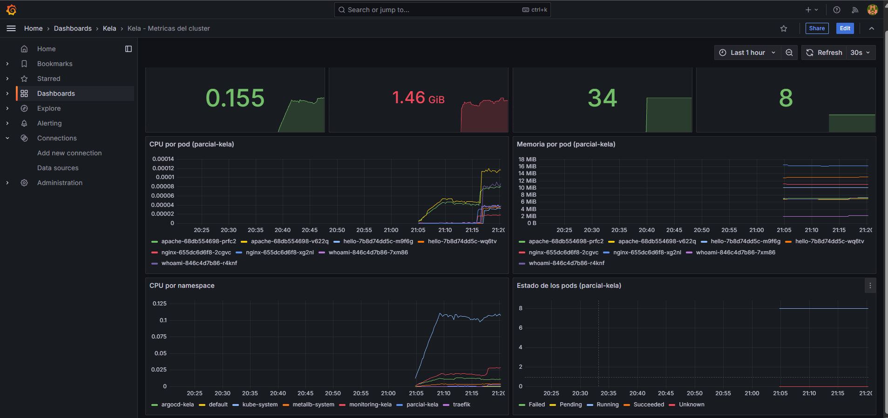
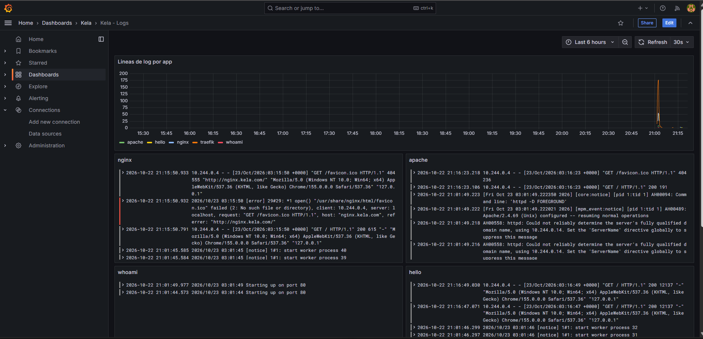
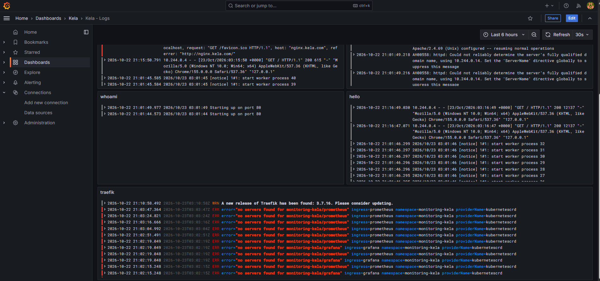
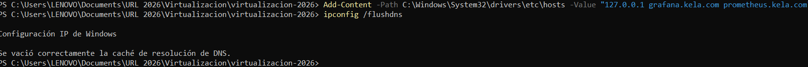
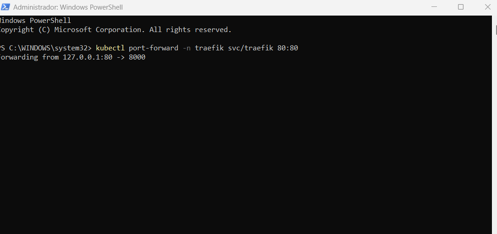

# Proyecto Personal I - Monitoreo
Karla Elizabeth Lopez Avila - 1510421

## Descripción

Se instaló un stack de monitoreo y logs en el clúster de Minikube de las actividades anteriores (con Traefik y MetalLB). Todos los componentes están en el namespace monitoring-kela:

- Prometheus: recolecta métricas del clúster (kubelet, cAdvisor y kube-state-metrics).
- Loki: almacena los logs.
- Promtail: DaemonSet que lee los logs de los contenedores de parcial-kela y traefik y los envía a Loki.
- Grafana: muestra las métricas y los logs. Los data sources y dashboards se cargan como código (provisioning).

Grafana y Prometheus se exponen con Traefik en grafana.kela.com y prometheus.kela.com. No se usó Helm, todo está en archivos YAML.

## Estructura

```
monitoring/
  kustomization.yaml
  namespace.yaml
  prometheus.yaml
  kube-state-metrics.yaml
  loki.yaml
  promtail.yaml
  grafana.yaml
  ingressroutes.yaml
  config/
    prometheus.yml
    loki.yaml
    promtail.yaml
    datasources.yaml
    dashboards.yaml
  dashboards/
    metricas.json
    logs.json
```

kustomization.yaml agrupa todo y crea los ConfigMaps a partir de los archivos de config/ y dashboards/.

## 1. Instalación

```powershell
minikube start --driver=docker
kubectl apply -k monitoring
kubectl get pods -n monitoring-kela
```





## 2. Prometheus

Prometheus usa un ServiceAccount con permisos para leer las métricas de los nodos. En `config/prometheus.yml` se definieron 4 jobs:

* prometheus: sus propias métricas
* kubelet: métricas del nodo
* cadvisor: CPU y memoria de cada contenedor 
* kube-state-metrics: estado de pods y deployments

```yaml
  - job_name: cadvisor
    scheme: https
    metrics_path: /metrics/cadvisor
    tls_config:
      insecure_skip_verify: true
    authorization:
      credentials_file: /var/run/secrets/kubernetes.io/serviceaccount/token
    kubernetes_sd_configs:
      - role: node
```

Todos los targets en estado UP:



## 3. Loki

Loki corre en modo single binary y guarda los logs en el sistema de archivos del pod (config/loki.yaml). Escucha en el puerto 3100.

## 4. Promtail

Promtail corre como DaemonSet y monta /var/log/pods del nodo. Usa el descubrimiento de pods de Kubernetes y solo se queda con los namespaces parcial-kela y traefik. A cada log le agrega las etiquetas namespace, pod, container y app.

```yaml
    relabel_configs:
      - source_labels: [__meta_kubernetes_namespace]
        regex: parcial-kela|traefik
        action: keep
      - source_labels: [__meta_kubernetes_pod_label_app]
        target_label: app
      - source_labels: [__meta_kubernetes_pod_uid, __meta_kubernetes_pod_container_name]
        separator: /
        target_label: __path__
        replacement: /var/log/pods/*$1/*.log
```

## 5. Grafana

Los data sources se configuran en `config/datasources.yaml`:

```yaml
apiVersion: 1
datasources:
  - name: Prometheus
    type: prometheus
    uid: prometheus
    access: proxy
    url: http://prometheus:9090
    isDefault: true
  - name: Loki
    type: loki
    uid: loki
    access: proxy
    url: http://loki:3100
```

Los dashboards están en dashboards/ como JSON y config/dashboards.yaml le indica a Grafana que los cargue desde /etc/grafana/dashboards. Aparecen en la carpeta Kela.

- Kela - Metricas del cluster: CPU y memoria del clúster, pods corriendo, CPU y memoria por pod de parcial-kela, CPU por namespace y estado de los pods.
- Kela - Logs: líneas de log por app y logs de nginx, apache, whoami, hello y traefik.





### Dashboard de métricas



### Dashboard de logs





En el panel de traefik aparecen errores no servers found for monitoring-kela/prometheus y monitoring-kela/grafana entre las 21:02 y las 21:03. Esto pasó justo después de aplicar los YAML: Traefik ya había leído los IngressRoute, pero los pods de Prometheus y Grafana todavía estaban arrancando y no había ningún pod listo detrás del Service. Cuando los pods pasaron a Running los errores dejaron de aparecer y los dos dominios respondieron bien.

## 6. DNS y exposición con Traefik

ingressroutes.yaml crea un IngressRoute para cada servicio:

```yaml
  routes:
  - kind: Rule
    match: Host(`grafana.kela.com`)
    services:
    - name: grafana
      port: 3000
```

Se agregaron los dominios al archivo hosts. Como en las tareas anteriores, en Windows con Docker Desktop la red de Minikube no es accesible desde el host, así que los dominios apuntan a 127.0.0.1 y se hace port-forward al Service LoadBalancer de Traefik (IP 192.168.49.240 de MetalLB).

```powershell
Add-Content -Path C:\Windows\System32\drivers\etc\hosts -Value "127.0.0.1 grafana.kela.com prometheus.kela.com"
kubectl port-forward -n traefik svc/traefik 80:80
```





Usuario de Grafana: admin / admin 
