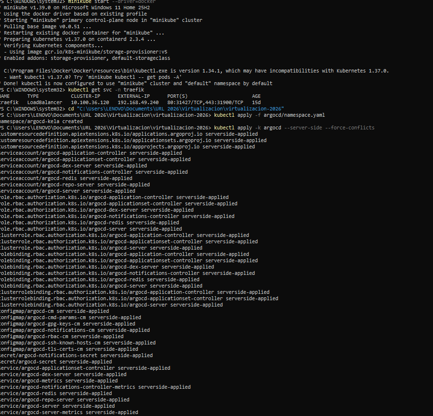
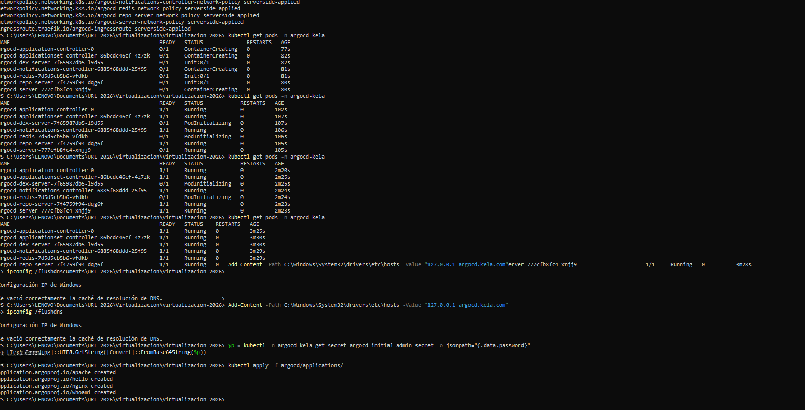
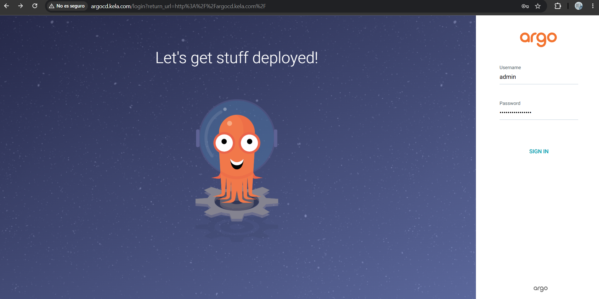
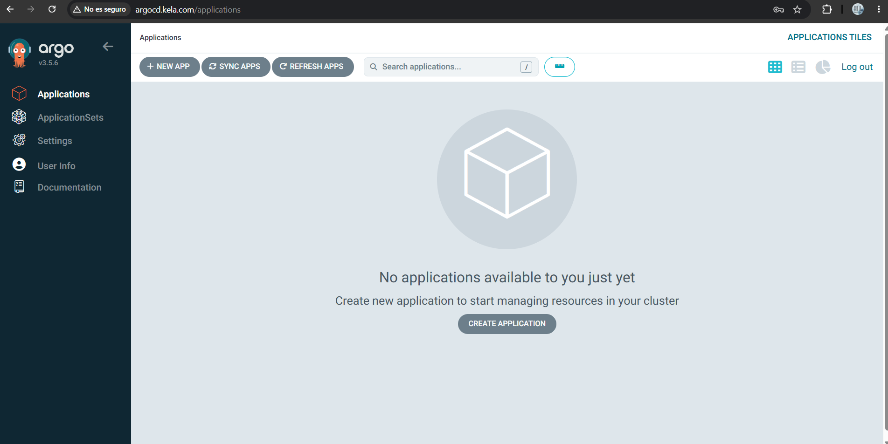
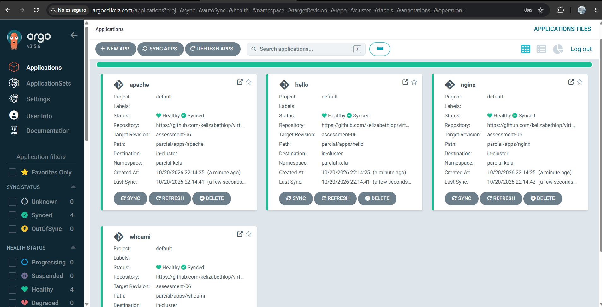
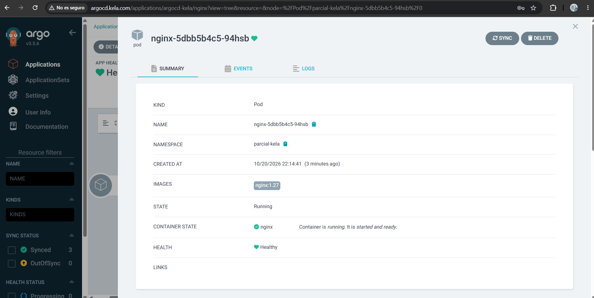
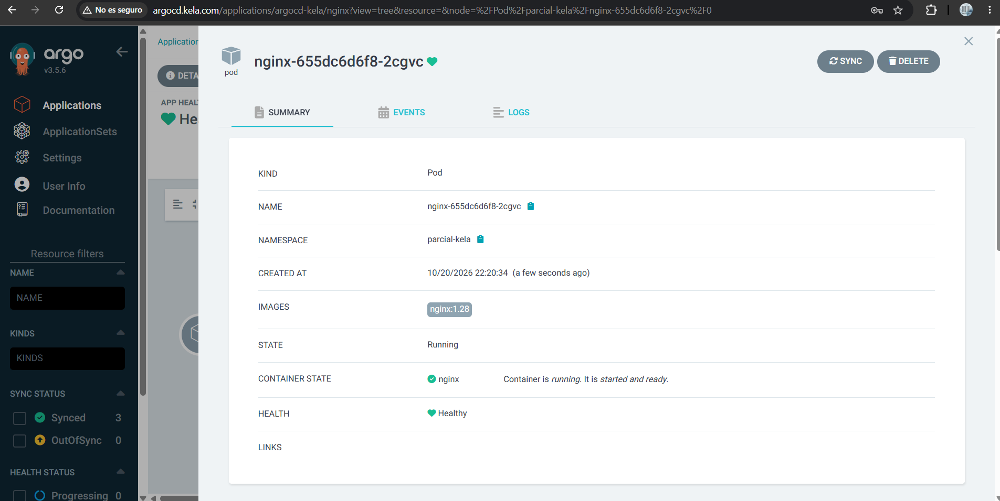

# Tarea 06 - ArgoCD
Karla Elizabeth Lopez Avila - 1510421

## Descripción

Se instaló ArgoCD en el clúster de Minikube del parcial, en el namespace argocd-kela. La interfaz web se expuso por medio de Traefik con el dominio argocd.kela.com. Se crearon 4 Applications que despliegan las aplicaciones del namespace parcial-kela desde este repositorio.

## Estructura del repositorio

```
argocd/
  namespace.yaml               namespace argocd-kela
  kustomization.yaml           instalación de ArgoCD
  argocd-cmd-params-cm.yaml    ArgoCD en modo HTTP (server.insecure)
  ingressroute.yaml            dominio argocd.kela.com en Traefik
  applications/                una Application por cada app
parcial/
  namespaces.yaml, metallb-config.yaml, traefik-rbac.yaml, traefik.yaml
  apps/nginx, apps/apache, apps/whoami, apps/hello
```

## 1. Instalación de ArgoCD

Se usó el manifiesto oficial de ArgoCD con Kustomize para instalarlo en el namespace argocd-kela. El manifiesto trae los ClusterRoleBinding apuntando al namespace argocd, por eso se agregó un patch para cambiarlo a argocd-kela. También se activó server.insecure: "true"` para que ArgoCD sirva por HTTP y Traefik lo pueda exponer sin certificados.

```yaml
apiVersion: kustomize.config.k8s.io/v1beta1
kind: Kustomization

namespace: argocd-kela

resources:
  - https://raw.githubusercontent.com/argoproj/argo-cd/stable/manifests/install.yaml
  - ingressroute.yaml

patches:
  - path: argocd-cmd-params-cm.yaml
  - patch: |-
      - op: replace
        path: /subjects/0/namespace
        value: argocd-kela
    target:
      kind: ClusterRoleBinding
```

```powershell
minikube start --driver=docker
kubectl apply -f argocd/namespace.yaml
kubectl apply -k argocd --server-side --force-conflicts
kubectl get pods -n argocd-kela
```





## 2. Exponer ArgoCD con Traefik

```yaml
apiVersion: traefik.io/v1alpha1
kind: IngressRoute
metadata:
  name: argocd-ingressroute
spec:
  entryPoints:
    - web
  routes:
  - kind: Rule
    match: Host(`argocd.kela.com`)
    services:
    - name: argocd-server
      port: 80
```

Se agregó el dominio al archivo hosts. Igual que en el parcial, en Windows con Docker Desktop la red de Minikube no es accesible desde el host, así que el dominio apunta a 127.0.0.1 y se hace port-forward al Service LoadBalancer de Traefik (IP 192.168.49.240 asignada por MetalLB):

```powershell
Add-Content -Path C:\Windows\System32\drivers\etc\hosts -Value "127.0.0.1 argocd.kela.com"
kubectl port-forward -n traefik svc/traefik 80:80
```


Contraseña inicial del usuario admin:

```powershell
$p = kubectl -n argocd-kela get secret argocd-initial-admin-secret -o jsonpath="{.data.password}"
[Text.Encoding]::UTF8.GetString([Convert]::FromBase64String($p))
```





## 3. Applications

Cada Application apunta a una carpeta de parcial/apps en la rama assessment-06 y despliega en el namespace parcial-kela. Con automated, prune y selfHeal, ArgoCD aplica solo los cambios que se suben al repositorio.

```yaml
apiVersion: argoproj.io/v1alpha1
kind: Application
metadata:
  name: nginx
  namespace: argocd-kela
spec:
  project: default
  source:
    repoURL: https://github.com/kelizabethlop/virtualizacion-2026.git
    targetRevision: assessment-06
    path: parcial/apps/nginx
  destination:
    server: https://kubernetes.default.svc
    namespace: parcial-kela
  syncPolicy:
    automated:
      prune: true
      selfHeal: true
    syncOptions:
      - CreateNamespace=true
```

```powershell
kubectl apply -f argocd/applications/
```

Las 4 Applications quedaron en estado Synced y Healthy:





## 4. Cambio en el repositorio

Se cambió la imagen de nginx en parcial/apps/nginx/nginx.yaml de nginx:1.27 a nginx:1.28 y se hizo push a la rama assessment-06. ArgoCD detectó el cambio, sincronizó la Application y creó pods nuevos con la imagen 1.28.



